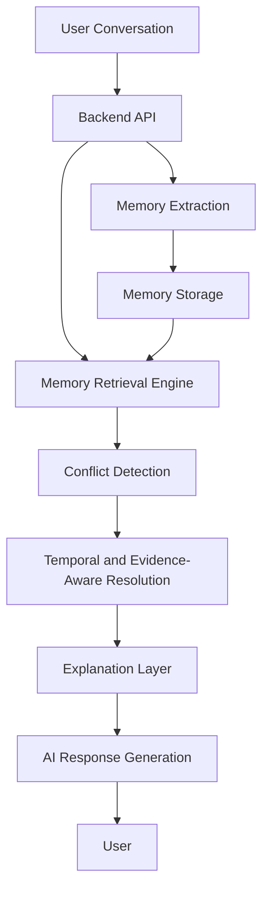

# Explainable Memory Intelligence

## Project Overview

Explainable Memory Intelligence is an AI-powered memory retrieval project designed to explore how intelligent systems can retain, organise, retrieve, and interpret information over time.

The project focuses on making AI memory systems more reliable by considering context, temporal changes, conflicting information, and the relevance of stored memories.

Unlike basic retrieval systems that primarily depend on similarity matching, this project aims to explore context-aware retrieval and explainable conflict resolution to improve the quality of AI-generated responses.

## Problem Statement

AI systems that interact with users over multiple sessions need an effective way to retain and retrieve relevant information.

However, traditional memory retrieval approaches can face challenges such as:

- Retrieving outdated or irrelevant information.
- Handling contradictory information from different conversations.
- Understanding changes in user preferences over time.
- Distinguishing between temporary context and long-term information.
- Explaining why particular information was retrieved or ignored.

This project explores approaches to address these challenges.

## Project Objectives

1. Explore persistent memory storage for conversational AI systems.
2. Implement semantic and hybrid memory retrieval approaches.
3. Investigate temporal changes and contradictory information.
4. Develop context-aware conflict detection and resolution methods.
5. Provide explanations for memory retrieval and resolution decisions.
6. Evaluate retrieval quality, conflict handling, and system performance.

## Proposed System Architecture

The proposed architecture consists of the following major components:

1. **User Interface:** Enables users to interact with the conversational memory system.
2. **Backend API:** Handles requests, application logic, and communication between components.
3. **Memory Extraction:** Identifies and structures relevant information from conversations.
4. **Memory Storage:** Maintains structured memories and their historical information.
5. **Retrieval Engine:** Retrieves relevant memories using semantic and keyword-based approaches.
6. **Conflict Resolution:** Examines contradictions, temporal validity, evidence, and contextual consistency.
7. **Explanation Layer:** Provides reasons behind memory selection and resolution decisions.
8. **AI Response Generation:** Produces responses grounded in the retrieved information.

### Architecture Flow



*Note: This represents the proposed system architecture. Components will be implemented and validated incrementally.*

## Proposed Technology Stack

| Component | Technology |
|---|---|
| Frontend | React |
| Backend | Python, FastAPI |
| AI Orchestration | LangGraph |
| Language Models | Gemini / Groq |
| Embeddings | Sentence Transformers |
| Database | PostgreSQL, pgvector |
| Retrieval | Semantic Search, Keyword Search |
| Testing | Pytest |
| Version Control | Git and GitHub |

## Setup Instructions

### Prerequisites

- Python 3.13 or compatible version
- Node.js and npm
- Git
- Visual Studio Code

### Clone the Repository

```bash
git clone YOUR_REPOSITORY_URL
cd YOUR_REPOSITORY_NAME
```

### Backend Environment Setup

```bash
python -m venv .venv
```

Activate the environment on Windows PowerShell:

```powershell
.venv\Scripts\Activate.ps1
```

Install the dependencies once the backend dependency file is available:

```bash
pip install -r backend/requirements.txt
```

### Frontend Setup

Once the frontend application is available:

```bash
cd frontend
npm install
npm run dev
```

*Note: These are planned setup instructions. The application dependencies and runnable components are still under development.*

## Usage

The intended workflow is:

1. A user interacts with the AI system.
2. Relevant information is extracted and stored as memories.
3. The retrieval engine searches for relevant stored information.
4. Potential conflicts and temporal changes are examined.
5. The system explains its retrieval and resolution decisions.
6. The AI generates a response using the selected information.

## Expected Outcomes

- Improved retrieval of relevant conversational memories.
- Better identification of contradictory and outdated information.
- Context-aware handling of changes over time.
- More transparent and explainable memory decisions.
- Evaluation of retrieval accuracy, conflict resolution, and response reliability.

## Current Project Status

**Status: Initial Development**

The project repository and initial documentation have been established. Development environment configuration and implementation of the proposed architecture are planned as incremental milestones.

## Future Scope

- Advanced hybrid retrieval and reranking.
- Temporal and evidence-aware conflict resolution.
- Explainable retrieval logs and visualisations.
- Comprehensive evaluation using benchmark scenarios.
- Deployment of the completed application.

## Author

B.E. Computer Science and Engineering Student

**Project:** Explainable Memory Intelligence